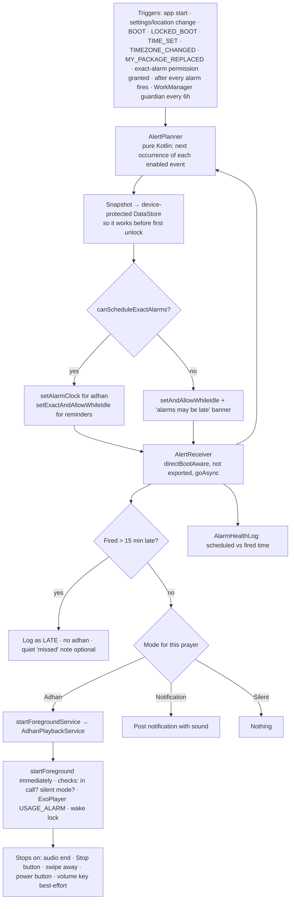

# Deen · دِين: Blueprint v0.1

> Status: **approved** 2026-10-09 · Milestone 0 (foundation) in progress.
> This is the plan of record; change it through pull requests like any other code.

---

## 0. Decisions so far

| Topic | Decision |
|---|---|
| App name | **Deen / دِين** |
| Package (`applicationId`) | **`io.github.themeshmaker.dunya`** (permanent) |
| GitHub | [`TheMeshMaker/deen`](https://github.com/TheMeshMaker/deen), public |
| Author / copyright | TheMeshMaker |
| License | GPL-3.0-or-later (code). Content keeps its own licenses (see `CONTENT_SOURCES.md`). |
| Min / target | minSdk 26 (Android 8) · compileSdk 37 · targetSdk 36, then 37 once Android 17 testing passes |
| Distribution | Google Play + F-Droid + GitHub Releases, via two flavors: `play` and `foss` |
| Monetisation | **No ads anywhere.** Play: Play Billing tips. FOSS: external donation links. |
| Languages | Arabic (full RTL) + English |
| Privacy | No analytics, no Firebase, no crash SDK. The FOSS build has **no INTERNET permission**. |
| Main test phone | A ColorOS 17 **CN** foldable on Android 17 (API 37) |

### Why the ad option was dropped
AdMob policy forbids asking users to view ads to "support us", including in rewarded ads ("watch this ad to support our business" is Google's own example of a banned phrase). Doing it anyway risks a permanent AdMob ban, so Deen uses tips only.

---

## 1. Product principles

1. **Reliability first.** An adhan that doesn't play is the worst bug this app can have. Everything in §9–10 serves that.
2. **Offline and private.** Calculations, content and audio all live on the device. Location is coarse, used once, and stored only on the phone.
3. **Calm, respectful UI.** No gamification, no streak pressure, no dark patterns, no "rate us" nagging.
4. **Honest sources.** Every hadith and dhikr shows its reference and grading. Release builds refuse content that a reviewer hasn't approved.
5. **Free forever.** No paywalls, no locked features, no ads.

---

## 2. v1 scope

| Area | v1 | Later |
|---|---|---|
| Prayer times | Offline calculation, all major methods, Hanafi/standard Asr, high-latitude rules, per-prayer minute offsets, Ramadan Isha +30 for Umm al-Qura | Iqama times, monthly timetable export |
| Alerts | Per prayer: Adhan / Notification / Silent. Optional pre-adhan reminder. Separate Fajr adhan. Pick your own audio file. | Jumu'ah / Al-Kahf reminder, auto-silent during prayer |
| Adhkar | Morning, Evening, Before sleep, After prayer. Tap-to-count with haptics. | More categories, adhkar reminders |
| Tasbih | Presets (33/33/34, 100, custom), ring progress, haptics, daily totals | Volume-key counting |
| Hadith | Daily card (Arabic + translation + reference + grading), copy/share | Browse/search, favourites |
| Qibla | Compass with accuracy indicator and calibration hint | — |
| Hijri | Umm al-Qura date with ±day adjustment | Islamic events calendar |
| Widget | Next prayer + live countdown | More sizes |
| Reliability | Setup checklist, OEM routing, "test adhan in 1 minute", alarm health log | — |
| Support | Tips (play) / links (foss), share, contribute | — |
| Platforms | Phones, foldables, tablets | Wear OS |
| Not planned | Quran reader in v1 (a big separate project) | — |

---

## 3. Tech stack

Exact versions get pinned in `gradle/libs.versions.toml` at scaffold time, using the newest stable releases that Android Studio 2026.1.3 supports (AGP 9.4).

| Layer | Choice |
|---|---|
| Language / build | Kotlin 2.x (K2), Gradle Kotlin DSL, version catalog, `build-logic` convention plugins |
| UI | Jetpack Compose, Material 3, Dynamic Color, `material3-adaptive` (NavigationSuiteScaffold, ListDetailPaneScaffold), Navigation Compose (type-safe routes) |
| Widget | Glance (plus RemoteViews `Chronometer` for the countdown) |
| DI | Hilt |
| Async | Coroutines + Flow |
| Persistence | Room (read-only content DB + user DB), DataStore |
| Background | AlarmManager for the adhan; WorkManager only as a safety net |
| Prayer math | `com.batoulapps.adhan:adhan2` (MIT) + kotlinx-datetime |
| Hijri | `android.icu.util.IslamicCalendar` (Umm al-Qura), built into Android |
| Audio | Media3 ExoPlayer inside our own foreground service |
| Location | Platform `LocationManager` (both flavors) + Fused Location (play only) + offline GeoNames city DB |
| Billing | Play Billing Library (play only) |
| Licenses screen | AboutLibraries |
| Quality | ktlint (via Spotless), Android Lint, Baseline Profiles; detekt once 2.0 is stable (only alphas exist as of Oct 2026) |
| Tests | JUnit, MockK, Turbine, Robolectric, Roborazzi (screenshots), Compose UI tests |

---

## 4. Repository and module layout

```
Deen/
├─ app/                      # Application, MainActivity, NavHost, flavor DI bindings
│  └─ src/{main,play,foss}/
├─ build-logic/              # convention plugins (android-library, compose, hilt, feature…)
├─ core/
│  ├─ model/                 # pure Kotlin data classes (PrayerDay, Dhikr, Hadith…)
│  ├─ domain/                # use cases + repository interfaces (pure Kotlin, no Android)
│  ├─ data/                  # repository implementations
│  ├─ database/              # Room: content.db (read-only) + user.db
│  ├─ datastore/             # settings + device-protected schedule snapshot
│  ├─ prayer/                # adhan2 wrapper, method presets, country→method map, Hijri
│  ├─ location/              # LocationSource interface, platform impl, city search
│  ├─ location-gms/          # Fused impl (play only)
│  ├─ alarm/                 # planner, scheduler, receivers, AdhanPlaybackService, health log
│  ├─ oem/                   # ROM detection, settings-intent table, reliability checks
│  ├─ billing/               # TipJar interface
│  ├─ billing-play/          # Play Billing impl (play only)
│  ├─ designsystem/          # theme, colors, type, shapes, components, geometric art
│  └─ ui/                    # shared composables (PrayerRow, ArabicText, CounterRing…)
├─ feature/
│  ├─ onboarding/  today/  adhkar/  tasbih/  qibla/
│  ├─ reliability/ settings/ support/ about/
├─ widget/                   # Glance next-prayer widget
├─ content/                  # source JSON for adhkar, hadith, verses + licenses (human-editable)
├─ tools/content-builder/    # JVM CLI: validates content → builds content.db
├─ docs/                     # this blueprint, ADRs, device test runbook
└─ fastlane/metadata/android/{en-US,ar}/   # store + F-Droid listings
```

**Dependency rule:** `feature → domain ← data`. Features never touch Room, AlarmManager or Android services directly; everything goes through domain interfaces. That keeps the core testable on the plain JVM.

---

## 5. Build flavors

| | `play` | `foss` |
|---|---|---|
| Location | Fused → platform → manual city | platform → manual city |
| Tips | Play Billing consumables | External links (GitHub Sponsors, etc.) |
| Exact alarms | `SCHEDULE_EXACT_ALARM` (user grants) | `SCHEDULE_EXACT_ALARM` + `USE_EXACT_ALARM` (auto-granted, no Play policy) |
| INTERNET permission | Only if the billing library requires it (checked in the merged manifest) | **None** |
| Proprietary code | Google Play services location + billing | **Zero.** CI fails the build if any `com.google.android.gms` or `billingclient` class shows up |

Flavor-specific implementations are bound in `app/src/play/.../FlavorModule.kt` and `app/src/foss/.../FlavorModule.kt`. Everything else is shared.

---

## 6. Architecture (Clean + MVI)

```
UI (Compose) ──Action──▶ ViewModel ──▶ UseCase ──▶ Repository (interface)
     ▲                       │                          ▲
     └──── StateFlow<UiState>┘        data module implements it
              + Effect channel (one-off: navigation, toasts, intents)
```

Every screen has the same shape:

```kotlin
data class TodayUiState(val next: NextPrayer?, val day: PrayerDay?, val hadith: Hadith?, val setupIssues: Int)
sealed interface TodayAction { data class ToggleAlert(val prayer: Prayer) : TodayAction; /* … */ }
sealed interface TodayEffect { data object OpenReliability : TodayEffect }
```

- State is immutable, and the screen collects it with `collectAsStateWithLifecycle`.
- The countdown is a per-second ticker that runs only while the screen is visible.
- Main use cases:
  - `ComputePrayerDay`
  - `ObserveNextPrayer`
  - `PlanAlerts`
  - `ScheduleAlerts`
  - `ResolveLocation`
  - `SuggestCalculationMethod`
  - `GetDailyHadith`
  - `ObserveAdhkar`
  - `CountTasbih`
  - `GetQiblaBearing`
  - `CheckReliability`

---

## 7. Prayer time engine (`core:prayer`)

- **Library:** adhan2 methods: Umm al-Qura, MWL, ISNA, Egypt, Karachi, Dubai, Kuwait, Qatar, Singapore, Moonsighting Committee. Extra presets built from custom angles: Turkey (Diyanet, approximate), Tehran, France (UOIF 12°), Russia and others, all reviewer-checked.
- **Auto method:** onboarding finds the nearest city in the offline DB, takes its country code and suggests a method from a country→method table (e.g. SA → Umm al-Qura, AE → Dubai, EG → Egypt, PK → Karachi, US/CA → ISNA, GB → Moonsighting Committee, MY/ID/SG → Singapore; anything else → MWL). The user confirms or changes it.
- **Asr:** Standard by default. Onboarding *suggests* Hanafi in Hanafi-majority countries; the user decides.
- **High latitude:** uses the library's recommended rule automatically above ~48°. It can be overridden.
- **Ramadan:** Umm al-Qura gets Isha +30 min during Ramadan (setting, on by default).
- **Adjustments:** ±minutes per prayer, ±days for the Hijri date.
- **Time zones:** each location stores its `ZoneId`. Times show in that location's zone (GPS → device zone; manual city → the city's zone).
- **Tests:** golden tables per method (§18), tolerance ±1 min.

---

## 8. Location (`core:location`)

- **Permission:** `ACCESS_COARSE_LOCATION` only (city-level accuracy is enough). No background location, ever.
- **Order of attempts:**
  1. *play:* Fused `getCurrentLocation(BALANCED_POWER)`, with a 15 s timeout.
  2. Platform `LocationManager.getCurrentLocation()` (fused → network → GPS), with a 20 s timeout.
  3. Last known location.
  4. **Manual city search**, offline, over the GeoNames `cities5000` subset (CC BY 4.0, roughly 2–3 MB compressed).
- **Why the platform path ships in the play build too:** on CN ROMs, Google location services often don't work even when they're installed (as on the main test phone).
- **Travel detection:** a `TIMEZONE_CHANGED` broadcast posts a quiet "You're in a new time zone, update location?" notification. No background tracking.
- **Debug menu:** "Pretend Google services are missing", to test the non-GMS path on a phone that has them.

---

## 9. Adhan alarm pipeline (`core:alarm`): the critical path

### 9.1 Design choices (and where they differ from the original brief)

| Brief said | Blueprint does | Why |
|---|---|---|
| `setExactAndAllowWhileIdle()` | **`setAlarmClock()` for the adhan itself.** `setExactAndAllowWhileIdle()` for pre-reminders. Inexact `setAndAllowWhileIdle()` only if exact permission is denied (with a warning). | `setAlarmClock` is the strongest guarantee Android offers: it exits Doze early and isn't throttled, and in practice OEM killers respect it most. Trade-off: an alarm icon in the status bar. A setting can turn it off, with a "less reliable" warning. |
| "combined with foreground services" | A foreground service **only while the adhan is playing** (`mediaPlayback` type). No always-on service. | Since Android 14, a permanent service needs a justified FGS type and Play review. Starting an FGS from an exact alarm is explicitly allowed, so a permanent one isn't needed. |
| — | The adhan always plays on the **alarm audio stream** (`USAGE_ALARM`) | **Android 17 background-audio hardening:** background audio silently fails unless the service has "while-in-use" status, *or* the app holds the exact-alarm permission and plays on `USAGE_ALARM`. Our service is started from an alarm (no while-in-use status), so the alarm stream is the only thing that works. "Respect silent mode" is handled in our own logic instead (§9.4). |

### 9.2 Flow



### 9.3 Details

- **Planner:** schedules only the *next* occurrence of each event (≤ 5 adhans + 5 reminders), and re-plans after each one fires. That's a small, deterministic set of PendingIntents with fixed request codes per (event kind, prayer), all `FLAG_IMMUTABLE`.
- **Boot:** `LOCKED_BOOT_COMPLETED` and `BOOT_COMPLETED` → reads the device-protected snapshot → schedules alarms. It **never** starts a foreground service from boot (Android 15 blocks `mediaPlayback` FGS from `BOOT_COMPLETED`). The result: if the phone reboots at night and isn't unlocked, Fajr still fires.
- **Guardian:** on app start and via a 6-hourly WorkManager job, it checks each planned PendingIntent with `FLAG_NO_CREATE`. If one is missing (the system or OEM cleared it), it reschedules and records a "cleared by system" event. The Reliability screen uses that to tell the user something is killing the app.
- **Exact-alarm permission revoked:** Android kills the app and cancels its alarms. On re-grant, `ACTION_SCHEDULE_EXACT_ALARM_PERMISSION_STATE_CHANGED` triggers a reschedule. The banner on the Today screen stays until it's fixed.

### 9.4 Playback service rules

| Situation | Behaviour |
|---|---|
| Phone call in progress (`MODE_IN_CALL` / `IN_COMMUNICATION`) | Notification only |
| Ringer silent/vibrate + "respect silent mode" ON (default) | Vibrate pattern + notification, no sound |
| Ringer silent + setting OFF | Plays on the alarm stream anyway |
| Audio focus | Request `GAIN_TRANSIENT`. On Android 17 the request may fail, so we play anyway; tested on Android 17 in `throw` hardening mode. |
| Fajr | Separate Fajr adhan audio |
| Short option | "Takbīr only" (the first phrase) |
| Custom audio | User picks a file through the system picker (persisted URI permission). No storage permission needed, and no licensing problem for us. |

### 9.5 Notification channels

| Channel | Importance | Sound |
|---|---|---|
| `adhan_playback` | High | Silent (the service plays the audio itself) |
| `prayer_notification` | High | Default notification sound |
| `prayer_reminder` | Default | Soft sound |
| `reliability` | Low | None |

---

## 10. Reliability center (`core:oem` + `feature:reliability`)

### 10.1 Checklist (live status)

```
┌────────────────────────────────────────┐
│ ←  Make sure the adhan always plays    │
│ Your phone: OPPO · ColorOS 17          │
│                                        │
│ ✅ Notifications allowed               │
│ ✅ Exact alarms allowed                │
│ ⬜ Battery: Unrestricted        [Fix]  │
│ ⬜ Allow auto-launch (OPPO)     [Open] │  ← can't be detected → user ticks it
│ ⬜ Lock Deen in recent apps     [How]  │  ← short animated guide
│                                        │
│ [ ▶  Test adhan in 1 minute ]          │  ← real alarm; asks you to lock the screen
│                                        │
│ Last 7 alarms: all on time ✓           │
│ ⚠ Alarms were cleared by the system    │  ← shown only if the guardian found it
│   yesterday 23:10. See tips →          │
└────────────────────────────────────────┘
```

### 10.2 OEM routing table (data-driven, contributors can fix it via PR)

Each vendor has an **ordered list of candidate intents**. The first one `resolveActivity()` accepts gets launched; otherwise it falls back to App info (`ACTION_APPLICATION_DETAILS_SETTINGS`), then to Settings. Each vendor also links to its dontkillmyapp.com guide.

| Vendor / ROM | Detection | Candidate screens (verify on real devices) | What the user must do |
|---|---|---|---|
| OPPO / OnePlus / realme: ColorOS, OxygenOS, realme UI | `ro.build.version.oplusrom` | ColorOS 17: per-app battery page `com.android.settings/.fuelgauge.AdvancedPowerUsageDetailActivity` (*verified on the ColorOS 17 CN test phone*). Older versions: `com.coloros.safecenter` startup manager. | Allow background activity, allow auto-launch, lock in recents |
| Xiaomi / Redmi / POCO: MIUI, HyperOS | `ro.miui.ui.version.name`, `ro.mi.os.version.name` | `com.miui.securitycenter` Autostart; `com.miui.powerkeeper` app battery saver | Autostart on, battery saver "No restrictions", lock in recents |
| vivo / iQOO: OriginOS, Funtouch | `ro.vivo.os.version` | `com.iqoo.secure` / `com.vivo.permissionmanager` background start-up manager | Allow high background power use, auto-start |
| Samsung: One UI | manufacturer | App battery page | "Unrestricted"; remove from Sleeping / Deep sleeping apps |
| Huawei / Honor: EMUI, HarmonyOS, MagicOS | `ro.build.version.emui` | `com.huawei.systemmanager` app launch manager | Manage manually: auto-launch, secondary launch, run in background |
| Motorola, Pixel, others | — | `ACTION_REQUEST_IGNORE_BATTERY_OPTIMIZATIONS` | Allow |

- **Battery-optimization dialog:** the FOSS build calls `ACTION_REQUEST_IGNORE_BATTERY_OPTIMIZATIONS` directly. Google Play restricts that permission to apps whose core function needs it. We'll declare it with the "alarm-critical" justification, and the code also supports falling back to the plain settings list (`ACTION_IGNORE_BATTERY_OPTIMIZATION_SETTINGS`) if Play objects.

---

## 11. Adhkar and Tasbih

### Adhkar reader

```
┌────────────────────────────────────────┐
│ ←  Morning adhkar               3 / 24 │
│ ▓▓▓▓▓░░░░░░░░░░░░░░░░░░░░░░░░░░░░░░░░ │
│ ╭────────────────────────────────────╮ │
│ │        أَصْبَحْنَا وَأَصْبَحَ الْمُلْكُ لِلَّهِ │ │  ← Amiri, adjustable size, line-height 1.9
│ │        ...                         │ │
│ │  ───────────────                   │ │
│ │  We have entered the morning and   │ │  ← translation (toggle)
│ │  the dominion belongs to Allah…    │ │
│ │                                    │ │
│ │  Muslim 2723 · Ṣaḥīḥ          ⓘ ⧉  │ │  ← reference · grading · virtue · copy
│ ╰────────────────────────────────────╯ │
│              ╭───────────╮             │
│              │   1 / 1   │             │  ← tap anywhere on the card to count
│              ╰───────────╯             │
└────────────────────────────────────────┘
```

- Reaching the count auto-advances (with a short delay) to the next dhikr.
- Progress is saved per day, so leaving and coming back resumes where you were.
- The card's position on the Today screen depends on the time: morning adhkar from Fajr until Dhuhr, evening adhkar from ʿAṣr until ʿIshāʾ.
- Unfolded or on tablets it becomes list + reader side by side (`ListDetailPaneScaffold`).

### Tasbih

```
┌────────────────────────────────────────┐
│  SubḥānAllāh ▾                     ↺   │
│                                        │
│            ╭───────────╮               │
│          ╱      27      ╲              │  ← ring fills toward the target
│          ╲     / 33     ╱              │  ← the whole lower half is the tap area
│            ╰───────────╯               │
│                                        │
│  Today: 312                            │  ← private, no streaks
└────────────────────────────────────────┘
```

- **Haptics:** `VibrationEffect.Composition` PRIMITIVE_TICK on each count and a stronger PRIMITIVE_CLICK when the target is reached. Falls back to `HapticFeedbackConstants` where primitives aren't supported.
- **Keep screen on:** optional.
- **Presets:** SubḥānAllāh 33 · Alḥamdulillāh 33 · Allāhu Akbar 34 · lā ilāha illā Allāh 100 · Astaghfirullāh 100 · custom.

---

## 12. Daily Hadith

- **Selection:** today's hadith = `collection[(epochDay + seed) mod N]`. Everyone sees the same hadith on the same day, offline and with no server.
- **Card:** Arabic text (Amiri), translation, narrator, `Collection · Book · Number`, grading + who graded it, copy and share buttons.
- **Optional notification:** off by default, after Fajr + X min.

---

## 13. Qibla, Hijri, widget

- **Qibla:** bearing from adhan2's `Qibla`; heading from `TYPE_ROTATION_VECTOR` corrected for magnetic declination (`GeomagneticField`). Also: an accuracy chip, a figure-8 calibration hint, a gentle haptic when aligned, and distance to Makkah.
- **Hijri:** ICU `IslamicCalendar` with `ISLAMIC_UMALQURA` + the user's day offset. Month names are localised.
- **Widget:** next prayer name, time and live countdown (RemoteViews `Chronometer`, so no per-second updates or battery cost). The alarm pipeline refreshes it at each prayer time.

---

## 14. Support screen (no ads)

```
┌────────────────────────────────────────┐
│ ←  Support Deen                        │
│                                        │
│  Deen is free forever: no ads, no      │
│  subscriptions. If it helps you, you   │
│  can help keep it going.               │
│                                        │
│  play:  [ Small tip ] [ Tip ] [ Big ]  │  ← Play Billing consumables, no perks
│  foss:  [ GitHub Sponsors ] [ … ]      │  ← external links
│                                        │
│  [ Share Deen ]  [ Rate ]              │
│  [ Help translate / contribute code ]  │
│                                        │
│  Jazākum Allāhu khayran 🤍              │  ← shown after a tip
└────────────────────────────────────────┘
```

- **Play build:** the screen never links to an outside payment page (Play policy; see the AnkiDroid case, Aug–Sep 2026).

---

## 15. Data and content pipeline

```
content/*.json  ──▶  tools/content-builder  ──▶  app/src/main/assets/content.db  (Room, read-only)
 (PR-reviewable)      • schema validation         user.db (separate) ← tasbih, adhkar progress,
                      • every item needs source     favourites, alarm health log
                        + grading + review status
                      • release build FAILS on unreviewed items
```

- **Dhikr record:** `id, category, order, arabic, translations{en,…}, repeat, virtue{…}, source{book, number}, grade{label, by}, review{status, reviewer, date}`
- **Hadith record:** same shape plus `narrator` and `collection`.
- **Quran verses** inside adhkar come from Tanzil (CC BY 3.0), unmodified and with attribution.
- **Why two databases:** shipping new content never needs a migration of user data. The content DB is simply replaced.
- **Settings:** a typed DataStore wrapper.
- **Device-protected store:** only the alarm snapshot.

---

## 16. UI/UX design

### 16.1 Design system (`core:designsystem`)

**Color**
- Dynamic Color is on by default (Android 12+).
- Fallback palette is generated from the seed **#1E6B57** (deep green), with a warm sand accent **#B8925A**.
- Light background: warm paper **#FBF8F1**.
- Theme modes: **Light · Dark · OLED Black**.
  - OLED Black uses pure `#000000` backgrounds and surfaces.
  - Instead of tonal elevation, it separates cards with hairline outlines.

**Type**
- UI text uses the system font (Roboto / system Arabic).
- Religious text uses **Amiri** (with Noto Naskh Arabic and Scheherazade New as options). Quranic text uses **Amiri Quran**. All are under the SIL Open Font License.
- The Arabic reading size is adjustable separately from the UI size.

**Numbers**
- Western (12:30) or Eastern Arabic (١٢:٣٠) digits, following the language by default.

**Shape and motion**
- M3 rounded shapes, an extra-large hero card on Today.
- Gentle motion that respects the system "remove animations" setting.

**Art**
- Original 8-fold geometric patterns, used subtly on the hero card and empty states.
- No figurative imagery, and patterns are checked to make sure they never form cross shapes.

**Icons**
- Material Symbols Rounded, plus custom icons for each prayer time (dawn, sunrise, sun, afternoon, sunset, night).

### 16.2 Navigation

- **Bottom bar:** Today · Adhkar · Tasbih · Qibla · More.
- **Large screens:** the bar becomes a navigation rail on unfolded and tablet screens (`NavigationSuiteScaffold`).
- **More:** Settings · Reliability · Support · About & licenses.

### 16.3 Today screen

**Phone (folded):**

```
┌────────────────────────────────────────┐
│ 📍 Riyadh ▾                         ⚙  │
│ Thursday, 9 Oct · {Hijri date}         │
│ ╭────────────────────────────────────╮ │
│ │░░ NEXT · ʿAṢR                15:12░│ │  ← hero card, geometric pattern
│ │░░        01:24:37                 ░│ │  ← live countdown
│ │░░ ▓▓▓▓▓▓▓▓▓░░░░░  since Dhuhr     ░│ │
│ ╰────────────────────────────────────╯ │
│ ⚠ Finish alarm setup (2 steps)      →  │  ← only when needed
│  Fajr      04:38            🔊          │
│  Sunrise   05:57             –          │
│  Dhuhr     11:43            🔊  ✓       │
│  ʿAṣr      15:12            🔊   ◀ next │
│  Maghrib   17:29            🔊          │
│  ʿIshāʾ    18:59            🔔          │  ← tap the icon: Adhan / Notification / Silent
│ ╭ Hadith of the day ─────────────────╮ │
│ │ إِنَّمَا الأَعْمَالُ بِالنِّيَّاتِ ...        │ │
│ │ "Actions are only by intentions…"  │ │
│ │ al-Bukhārī 1 · Ṣaḥīḥ        ⧉  ↗   │ │
│ ╰────────────────────────────────────╯ │
│  ☀ Morning adhkar  →                   │  ← changes with the time of day
├────────────────────────────────────────┤
│ Today  Adhkar  Tasbih  Qibla   More    │
└────────────────────────────────────────┘
```

Times in these wireframes are examples.

**Unfolded (foldable inner screen) / tablet:**

```
┌─────┬──────────────────────────┬──────────────────────────┐
│Today│  Hero card + countdown   │  Hadith of the day       │
│Adhkr│  Six prayer rows         │  Adhkar shortcut         │
│Tasbh│                          │  Hijri / location card   │
│Qibla│                          │                          │
│More │                          │                          │
└─────┴──────────────────────────┴──────────────────────────┘
```

### 16.4 Onboarding (each step skippable except location)

1. Welcome + language
2. Location: auto, or search a city
3. Calculation method (pre-selected by country, explained in one line)
4. Notifications permission
5. Exact alarms permission
6. Reliability setup (the vendor-specific checklist from §10)
7. Done: "Next prayer: ʿAṣr at 15:12"

### 16.5 Settings

- **Prayer times:** method · Asr · high-latitude rule · per-prayer offsets · Ramadan Isha · Hijri offset
- **Adhan & alerts:**
  - per-prayer mode
  - adhan voice and Fajr voice
  - custom file
  - pre-reminder
  - respect silent mode
  - power button stops the adhan
  - use system alarm (`setAlarmClock`)
- **Reading:** Arabic font and size · translation on/off · digits
- **Appearance:** theme · dynamic color · language
- **Location:** current location · update now · manual city
- **Reliability**
- **About:** version, sources, licenses, privacy

### 16.6 Accessibility, RTL, large screens

- **RTL:** full mirroring. The in-app language picker uses Android 13+ per-app language, with an AppCompat fallback on older versions.
- **TalkBack:** every control has a label. The countdown is announced politely once a minute, not every second.
- **Sizing and contrast:** 48 dp touch targets, layouts that survive 200 % font scale, WCAG AA contrast in all three themes.
- **Large screens:** API 36 ignores orientation locks on screens 600 dp and wider, so every screen gets tested landscape and unfolded (the foldable test phone covers this).

---

## 17. Permissions and privacy

| Permission | Flavor | When asked | Why |
|---|---|---|---|
| `ACCESS_COARSE_LOCATION` | both | Onboarding / "update location" | City-level prayer times |
| `POST_NOTIFICATIONS` | both | Onboarding | Adhan and reminders |
| `SCHEDULE_EXACT_ALARM` | both | Onboarding (settings screen) | On-time adhan |
| `USE_EXACT_ALARM` | foss | Auto-granted | Same, without asking |
| `REQUEST_IGNORE_BATTERY_OPTIMIZATIONS` | both | Reliability step | Survive Doze / OEM killers |
| `RECEIVE_BOOT_COMPLETED` | both | — | Reschedule after reboot |
| `FOREGROUND_SERVICE` + `_MEDIA_PLAYBACK` | both | — | Playing the adhan |
| `WAKE_LOCK`, `VIBRATE` | both | — | Playback, haptics |
| `INTERNET` | play only, if billing requires it | — | Play Billing |

- **Not requested:** background location, storage, contacts, phone state, DND access (v1).
- `PRIVACY.md` (also served on GitHub Pages) says plainly: *nothing leaves your device.*
- The Play Data Safety form will declare "no data collected" (plus whatever Play Billing requires).

---

## 18. Testing strategy

**Unit tests (JVM, fast)**
- **Prayer golden tests:** official Umm al-Qura times for Makkah and Riyadh, plus MWL London, ISNA New York, Karachi, Moonsighting Committee UK and a high-latitude city (Oslo). Tolerance ±1 min.
- **AlertPlanner with a fake clock:** midnight rollover, DST jumps, time zone change, Isha after midnight in summer at high latitude, Ramadan +30, every per-prayer mode.
- **Other unit tests:** Hijri offset, country→method suggestion, daily hadith selection, OEM detection and route resolution.

**Android tests**
- **Robolectric:** receivers and scheduler, using the `ShadowAlarmManager` test helper.
- **Roborazzi screenshots:** every screen × Light/Dark/OLED × LTR/RTL × phone/unfolded.
- **Compose UI tests:** onboarding and tasbih counting.

**Device runbook (`docs/device-testing.md`), run on the ColorOS test phone:**

```bash
adb shell dumpsys alarm | grep -A4 io.github.themeshmaker.dunya
adb shell dumpsys deviceidle force-idle
adb shell am set-standby-bucket io.github.themeshmaker.dunya restricted
adb shell cmd audio set-enable-hardening throw
adb reboot
```

**Scenarios on the phone**
- Adhan while Doze is forced on
- Adhan in the "restricted" standby bucket
- Android 17 audio hardening set to `throw`
- Reboot without unlocking → Fajr must still fire
- Swipe the app away from recents / ColorOS "clear all"
- Overnight idle → the health log shows the drift of every alarm

**Beta matrix:** the maintainer plus community testers on Xiaomi/HyperOS, vivo/OriginOS, Samsung, Huawei/Honor (no Google services). The health log can be exported and attached to bug reports.

---

## 19. CI/CD and release

- **`ci.yml` (every PR):**
  1. Spotless + detekt
  2. Unit tests
  3. Lint
  4. Build `playDebug` and `fossDebug`
  5. Validate content
  6. "foss contains no Google code" check
  7. Screenshot diff
- **`release.yml` (tag `v*`):**
  1. Signed AAB (play) and APK (foss); the signing key and passwords live only in GitHub Secrets, added by the maintainer
  2. GitHub Release with changelog
  3. Optionally upload to the Play internal track later
- **Dependencies:** Renovate/Dependabot updates.
- **Reproducible foss builds**, so F-Droid can publish the maintainer-signed APK.
- **Repo files:**
  - `README` (AR/EN), `LICENSE`, `CONTRIBUTING`, `CODE_OF_CONDUCT`, `SECURITY`
  - `PRIVACY.md`, `CONTENT_SOURCES.md`
  - `.github/FUNDING.yml` (adds GitHub's Sponsor button to the repo page)
  - issue templates (with a "phone model / ROM / health log" section for alarm bugs)

---

## 20. Milestones

| # | Milestone | Done when |
|---|---|---|
| **M0** | Foundation | Repo, build-logic, flavors, CI green, design system, empty screens in the nav shell, runs on the test phone |
| **M1** | Prayer times | Engine + golden tests, location (both paths + city search), onboarding, Today screen with live countdown |
| **M2** | Adhan | Alarm pipeline, playback service, notifications, Reliability center, health log, all device scenarios pass on ColorOS 17 CN |
| **M3** | Adhkar and Tasbih | Content pipeline, reader, counter, haptics (sample content is debug-only until reviewed) |
| **M4** | Hadith, Qibla, Hijri, widget | All four working, plus screenshot tests |
| **M5** | Support, settings, polish | Tips/links, full settings, Arabic/English, accessibility pass, large-screen layouts |
| **M6** | Release | Privacy policy, store and F-Droid listings, Play closed test, OEM beta, v1.0 |

---

## 21. Open items (needed from the maintainer, and by when)

| Item | Needed by |
|---|---|
| ~~Confirm package spelling~~ `io.github.themeshmaker.dunya` | ✅ done |
| ~~Repo name + public repo~~ `TheMeshMaker/deen` | ✅ done |
| Adhan recordings we have the rights to (or approved CC-licensed ones) | M2 |
| Hadith collections + translation languages | M3 |
| Religious reviewer (name/contact) | M3 (content can't ship without them) |
| Donation links (apply for GitHub Sponsors early, approval takes time) + tip amounts | M5 |
| Google Play developer account + upload keystore (maintainer creates both) | M6 |
